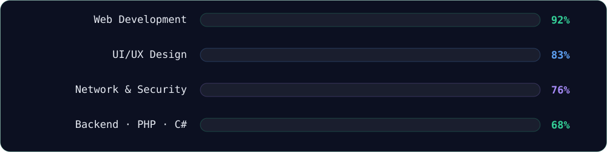

<div align="center">




<p>
  <a href="https://amirmsr.tech"></a>
  <a href="https://arizoteam.ir"></a>
  <a href="https://t.me/ArizoSupport"></a>
  <a href="https://instagram.com/ArizoCompany"></a>
  <a href="mailto:ArizoSupport@gmail.com"></a>
</p>

</div>

<div align="center"></div>

<table width="100%">
<tr>
<td width="55%" valign="top">

### `// Identity`

```yaml
name:      "Amir Hossein Tighi (AmirMSR)"
location:  "Tabriz, East Azerbaijan, Iran"
studio:    "Arizo — Development & Design Studio"
education: "Software Engineering · FanniHerfeyi Uni"
status:    ONLINE ✅
```

### `// What I do`

```bash
[01] Full-Stack Development   → modern, fast web systems
[02] Network & Security       → secure architecture, pen-testing
[03] UI/UX & Brand Identity   → clean visuals, clear experience
[04] Smart Solutions          → AI-powered apps, stable infrastructure
```

</td>
<td width="45%" align="center" valign="middle">

<a href="https://github.com/ArizoOwner/Arizo_Agent/releases/latest">
  
</a>

<br/><br/>

> **Now shipping:** *Arizo Translate* — a Dynamic&nbsp;Island translator for Windows.
> Select text, press a shortcut, get the translation in place.

<br/>


</td>
</tr>
</table>

<div align="center"></div>

<div align="center">

**Frontend & visual engineering**<br/>


<br/>

**Backend, logic & data**<br/>


<br/>

**Security, systems & ops**<br/>


<br/><br/>



<sub>Self-rated, not measured.</sub>

</div>

<div align="center"></div>

<table width="100%">
<tr>
<td width="50%" valign="top" align="center">

### 🏝️ Arizo Translate

<a href="https://github.com/ArizoOwner/Arizo_Agent">
  
</a>

> **A Dynamic Island translator for Windows 10/11**<br/>
> Translate anything, anywhere, in place. Fast and AI engines, Persian ⇄ English first.


</td>
<td width="50%" valign="top" align="center">

### 🤖 Arizo Self

<a href="https://github.com/ArizoOwner/Arizo_Self">
  
</a>

> **Telegram Self Manager**<br/>
> Advanced personal-account and AI automation core.


</td>
</tr>
<tr>
<td width="50%" valign="top" align="center">

### 🌐 ArizoTeam.ir

<a href="https://arizoteam.ir"></a>

> **Arizo Team official website**


</td>
<td width="50%" valign="top" align="center">

### 🎮 ArizoGame.ir

<a href="https://arizogame.ir"></a>

> **Gaming platform with a full backend**


</td>
</tr>
<tr>
<td width="50%" valign="top" align="center">

### 🖨️ Bozorgmehr Digital Print

<a href="https://bozorgmehrofficial.ir"></a>

> **Corporate website + SEO**


</td>
<td width="50%" valign="top" align="center">

### 💻 amirmsr.tech

<a href="https://amirmsr.tech"></a>

> **Personal portfolio & interactive canvas**


</td>
</tr>
</table>

<div align="center">

<br/>

<a href="https://github.com/ArizoOwner">
  
</a>
&nbsp;
<a href="https://github.com/ArizoOwner">
  
</a>

<br/><br/>

<a href="https://github.com/ArizoOwner">
  
</a>

</div>

<div align="center"></div>

<div align="center">

**Have a project, a bug or an idea?** Message me on [Telegram](https://t.me/ArizoSupport) or write to [ArizoSupport@gmail.com](mailto:ArizoSupport@gmail.com).


</div>
