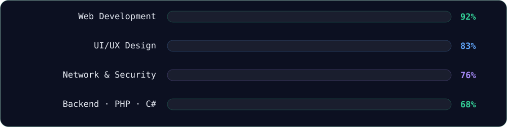
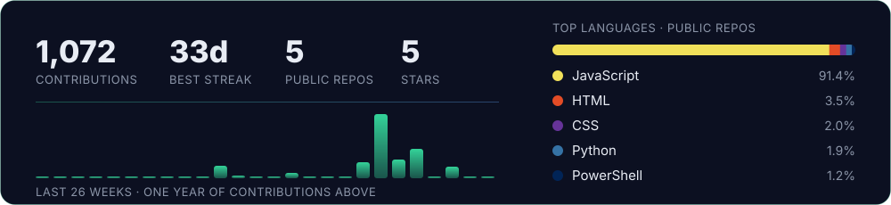

<div align="center">




<p>
  <a href="https://arizoteam.ir"></a>
  <a href="https://t.me/ArizoSupport"></a>
  <a href="https://instagram.com/ArizoCompany"></a>
  <a href="mailto:ArizoSupport@gmail.com"></a>
</p>

</div>

<div align="center"></div>

<table width="100%">
<tr>
<td width="55%" valign="top">

### `// Identity`

```yaml
name:      "Amir Hossein MSR"
location:  "Iran"
studio:    "Arizo — Development & Design Studio"
education: "Software Engineering · FanniHerfeyi Uni"
status:    ONLINE ✅
```

### `// What I do`

```bash
[01] Full-Stack Development   → modern, fast web systems
[02] Network & Security       → secure architecture, pen-testing
[03] UI/UX & Brand Identity   → clean visuals, clear experience
[04] Smart Solutions          → AI-powered apps, stable infrastructure
```

</td>
<td width="45%" align="center" valign="middle">

<a href="https://arizoteam.ir">
  
</a>
<a href="https://github.com/ArizoOwner/Arizo_Agent/releases/latest">
  
</a>

<br/><br/>

> **Now shipping:** *Arizo-Agent 1.3* — a Dynamic&nbsp;Island for Windows,
> with a little robot named Ari. New: drive **Claude Code** and **Antigravity**
> on your PC from your phone, from anywhere. Get it at [arizoteam.ir](https://arizoteam.ir).

<br/>


</td>
</tr>
</table>

<div align="center"></div>

<div align="center">

**Frontend & visual engineering**<br/>


<br/>

**Backend, logic & data**<br/>


<br/>

**Security, systems & ops**<br/>


<br/><br/>



<sub>Self-rated, not measured.</sub>

</div>

<div align="center"></div>

<div align="center"><a href="https://arizoteam.ir"></a></div>

<table width="100%">
<tr>
<td width="50%" valign="top" align="center">

### 🏝️ Arizo-Agent

<a href="https://arizoteam.ir"></a>

> **A Dynamic Island for Windows 10/11**<br/>
> Translate in place, Spotify, live football and crypto — with Ari the robot.<br/>
> **The Bridge:** your phone and a second PC, at home or from anywhere through your own relay.<br/>
> **Your AI on the go:** chat with Claude Code and Antigravity on the PC, approve each step from the phone.

[](https://github.com/ArizoOwner/Arizo_Agent)


</td>
<td width="50%" valign="top" align="center">

### 🤖 Arizo Self

<a href="https://github.com/ArizoOwner/Arizo_Self">
  
</a>

> **Telegram Self Manager**<br/>
> Advanced personal-account and AI automation core.


</td>
</tr>
<tr>
<td width="50%" valign="top" align="center">

### 🌐 ArizoTeam.ir

<a href="https://arizoteam.ir"></a>

> **Arizo Team official website**


</td>
<td width="50%" valign="top" align="center">

### 🎮 ArizoGame.ir

<a href="https://arizogame.ir"></a>

> **Gaming platform with a full backend**


</td>
</tr>
<tr>
<td width="50%" valign="top" align="center">

### 🎬 Arizo Movie

<a href="https://github.com/ArizoOwner/Arizo_Movie"></a>

> **24/7 Telegram movie bot**<br/>
> Cloudflare Workers + D1, TMDB, and a web set-up wizard.


</td>
<td width="50%" valign="top" align="center">

### 🖨️ Bozorgmehr Digital Print

<a href="https://bozorgmehrofficial.ir"></a>

> **Corporate website + SEO**


</td>
</tr>
</table>

<div align="center">

<br/>



</div>

<div align="center"></div>

<div align="center">

**Have a project, a bug or an idea?** Message me on [Telegram](https://t.me/ArizoSupport) or write to [ArizoSupport@gmail.com](mailto:ArizoSupport@gmail.com).


</div>
