<div align="center">



<p>
  <a href="https://arizoteam.ir"></a>
  <a href="https://t.me/ArizoSupport"></a>
  <a href="https://instagram.com/ArizoCompany"></a>
  <a href="mailto:ArizoSupport@gmail.com"></a>
</p>


</div>

<table width="100%">
<tr>
<td width="55%" valign="top">

```yaml
name:      "AmirHossein Tighi"   # AmirMSR
location:  "Iran"
studio:    "Arizo — Development & Design Studio"
education: "Software Engineering · Fanni-Herfeyi University"
shipping:  "Arizo-Agent 2.2 — Game Mode"
status:    ONLINE
```

```bash
[01] Full-Stack Development  → fast web systems and desktop apps
[02] Network & Security      → secure architecture, pen-testing
[03] UI/UX & Brand Identity  → clean visuals, clear experience
[04] Smart Solutions         → AI-powered apps, stable infrastructure
```

</td>
<td width="45%" align="center" valign="middle">

<a href="https://arizoteam.ir"></a>
<a href="https://github.com/ArizoOwner/Arizo_Agent/releases/latest"></a>

<br/><br/>

> **Now shipping: Arizo-Agent 2.2** — a Dynamic Island for Windows
> with a little robot named Ari. New: **Game Mode**, with a real FPS
> counter and CPU, GPU and temperature beside Ari while you play.

<br/>


</td>
</tr>
</table>

<div align="center">


<a href="https://github.com/ArizoOwner/Arizo_Agent"></a>

</div>

<table width="100%">
<tr>
<td width="50%" valign="top" align="center">

### Arizo-Agent

<a href="https://arizoteam.ir"></a>

> **A Dynamic Island for Windows 10/11**<br/>
> Translate in place, Spotify, live football and crypto, Game Mode — with Ari the robot.<br/>
> **The Bridge:** your phone and a second PC, at home or from anywhere through your own relay.<br/>
> **Your AI on the go:** Claude Code and Antigravity on the PC, approved step by step from the phone.

[](https://github.com/ArizoOwner/Arizo_Agent)


</td>
<td width="50%" valign="top" align="center">

### Arizo Self

<a href="https://github.com/ArizoOwner/Arizo_Self"></a>

> **Telegram Self Manager**<br/>
> Advanced personal-account and AI automation core.


</td>
</tr>
<tr>
<td width="50%" valign="top" align="center">

### Arizo Movie

<a href="https://github.com/ArizoOwner/Arizo_Movie"></a>

> **24/7 Telegram movie bot**<br/>
> Cloudflare Workers + D1, TMDB, and a web set-up wizard.


</td>
<td width="50%" valign="top" align="center">

### ArizoTeam.ir

<a href="https://arizoteam.ir"></a>

> **The Arizo studio's home** — and Arizo-Agent's downloads, accounts and news.


</td>
</tr>
<tr>
<td width="50%" valign="top" align="center">

### ArizoGame.ir

<a href="https://arizogame.ir"></a>

> **Gaming platform with a full backend**


</td>
<td width="50%" valign="top" align="center">

### Bozorgmehr Digital Print

<a href="https://bozorgmehrofficial.ir"></a>

> **Corporate website + SEO**


</td>
</tr>
</table>

<div align="center">


**Frontend & visual engineering**<br/>


<br/><br/>

**Backend, logic & data**<br/>


<br/><br/>

**Security, systems & ops**<br/>


**Have a project, a bug or an idea?** Message me on [Telegram](https://t.me/ArizoSupport), on [Instagram](https://instagram.com/ArizoCompany) or write to [ArizoSupport@gmail.com](mailto:ArizoSupport@gmail.com).

<a href="https://arizoteam.ir"></a>

</div>
